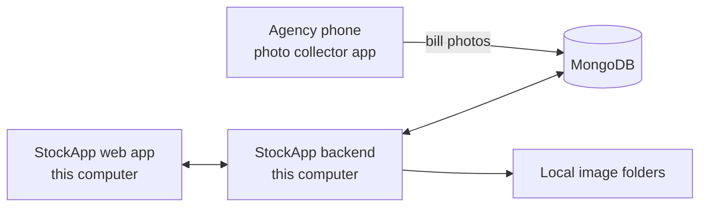

# StockApp

Inventory, sales and credit management for a distribution business with cash and credit customers, cheque payments and paper bills.

StockApp reads photos of printed bills into editable sales, tracks what each customer owes, tells you which cheques to deposit today, and forecasts what to order next.

> **Runs on your own computer.** The app has no sign-in, so its API only accepts connections from the same computer. Add login before putting it on a network or online.

## Features

### Sales and bills
- Enter sales by hand, or add a bill photo and check the details it fills in
- Reads items, MRP, pack size, quantities, rates, free items, customer, bill number, bill date and total from printed distributor invoices
- Sell by cases and pieces from any store or lorry
- Refuses the same bill number twice for an agency
- Bill text is read in your browser with Tesseract, so images are not sent to an OCR service

### Credit and cheques
- Cash, cheque or credit on any bill, with credit due 21 days from the bill date by default
- Full or part payments, with the oldest bill settled first when no bill is chosen
- Cheque tracker: missed, deposit today, at the bank, bounced, upcoming and cleared
- A cheque cannot be deposited before its date and only counts as paid once it clears; if it bounces, the amount returns to the bill

### Stock
- **Sales only take stock out, and restocks add it.** A sale that needs more than you have stops and offers to restock first
- Restock from a company invoice image or by hand, creating new items with MRP, cost and pack size
- Transfers between locations, and count corrections
- A page for each item with stock by location, monthly sales and receipts, top buyers and full history

### Customers and reports
- A page for each customer with totals, balance, monthly chart, top items, bills and cheques
- Home page listing what needs attention today

### What to order
Forecasts weekly demand from the last 26 weeks using exponential smoothing, then works out safety stock, a reorder point and an order size rounded to whole cases. You set the delivery time, how long an order should last and how careful to be about running out. Items with little history are marked as rough guesses. Export the list as a spreadsheet file.

### Photos from agencies
A separate mobile app lets each agency send daily bill photos, even with a weak signal. They appear under **Bill photos** to enter as sales. Photos sent after midnight of the bill's day, Sri Lanka time, stay out of the list until you accept them.

Accepted images are also copied to a folder on your computer:

```text
StockApp Images/
├── Daily Bills/<Agency>/<YYYY-MM-DD>/
├── Company Invoices/<YYYY-MM-DD>/
└── Removed By Agency/
```

## How it fits together



## Tech stack

| Part | Built with |
|---|---|
| Web app | React 18, React Router, Tailwind CSS, Tesseract.js |
| API | Node.js, Express 5, Mongoose |
| Database | MongoDB with transactions (Atlas or a replica set) |
| Tests | Node test runner, Jest, mongodb-memory-server |

## Getting started

You need Node.js 20 or newer and a MongoDB database that supports transactions, such as MongoDB Atlas. A single standalone MongoDB server will not work.

**1. Start the API**

```bash
cd stockapp-backend
npm install
```

Create `stockapp-backend/.env`:

```env
MONGODB_URI=your_connection_string
PORT=5001
```

```bash
npm start
```

**2. Start the web app in a second terminal**

```bash
cd stockapp-frontend
npm install
npm start
```

Open http://localhost:3000. The first bill scan needs internet to download the OCR engine.

### Optional settings

| Setting | Default | Purpose |
|---|---|---|
| `IMAGES_DIR` | `~/StockApp Images` | Where images are saved |
| `BUSINESS_TZ` | `Asia/Colombo` | Time zone for business days |
| `HOST` | `127.0.0.1` | Address the API listens on. Do not widen this without adding login |
| `CORS_ORIGIN` | `http://localhost:3000` | The web address allowed to call the API |

## Project structure

```text
stockapp-backend/     Express API
  controllers/        Sales, payments, restocks, reports
  models/             Database schemas
  routes/             API routes
  utils/              Billing, forecast, image folders
  test/               API and forecast tests
stockapp-frontend/    React app
  src/pages/          One file per screen
  src/components/     Layout, shared UI, charts
  src/utils/          Bill reader and OCR
```

## Tests

```bash
cd stockapp-backend && npm test
cd stockapp-frontend && CI=true npx react-scripts test --watchAll=false
```

Backend tests use a temporary in-memory database and a temporary image folder, so they never touch your data.

## Known limits

- Bill reading is built for one printed invoice layout. Handwritten bills need entering by hand.
- Forecasts need about 8 weeks of sales to be useful, and do not yet account for seasons or for orders on the way.
- Transfers and count corrections change stock but do not appear in an item's history.
